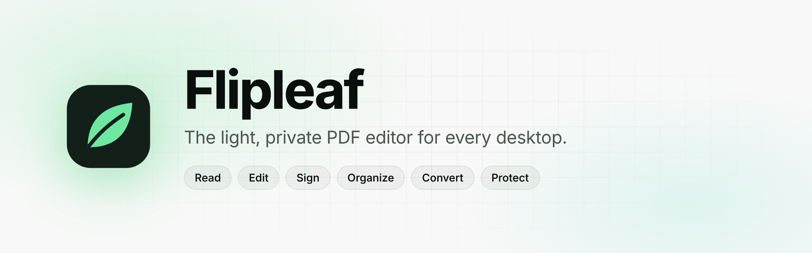
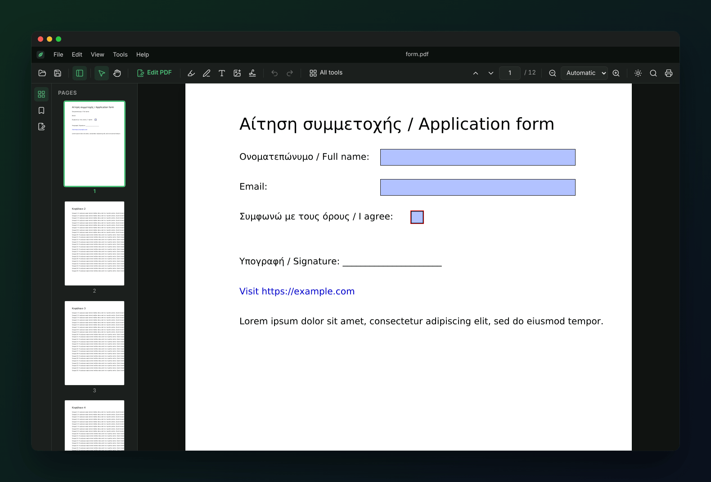
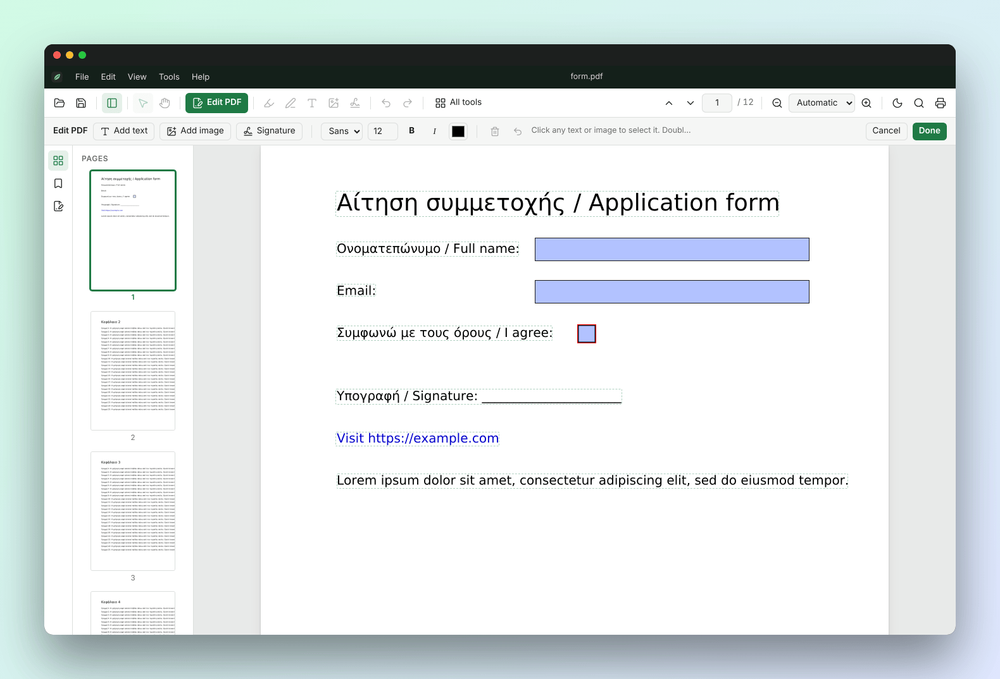
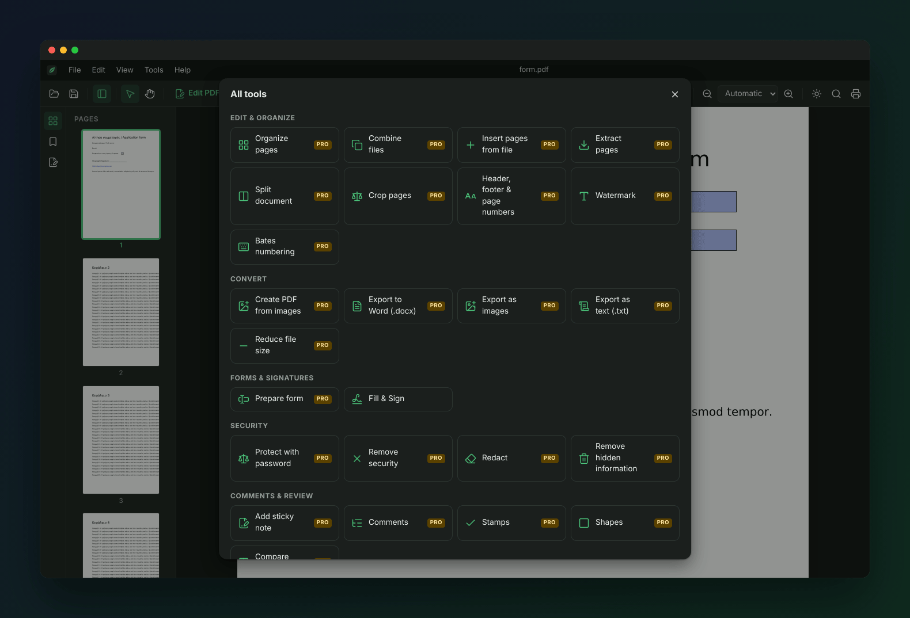
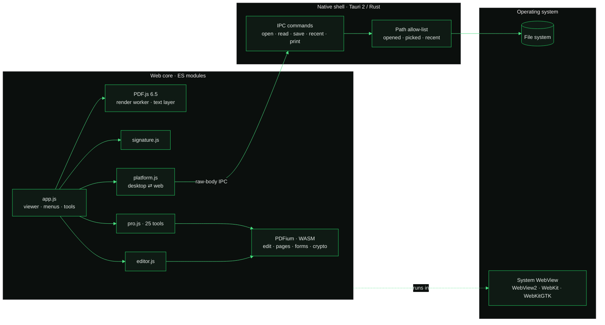

<picture>
  <source media="(prefers-color-scheme: dark)" srcset="docs/banner-dark.png">
  
</picture>

<p align="center">
  <a href="https://github.com/vasileiostripolidis/flipleaf/releases/latest"></a>
  <a href="https://github.com/vasileiostripolidis/flipleaf/releases/latest"></a>
  <a href="https://github.com/vasileiostripolidis/flipleaf/releases/latest"></a>
  <a href="https://vasileiostripolidis.github.io/flipleaf/"></a>
</p>

<p align="center">
  
  
  
  
  
</p>

<br>

<p align="center"></p>

<br>

## Overview

Flipleaf is a cross-platform PDF reader and editor: a small native shell (Tauri 2 / Rust) wrapped around a web core. Mozilla's PDF.js renders the documents and Google's PDFium, compiled to WebAssembly, handles editing. It installs in seconds, starts instantly and never sends anything over the network.

|  |  |
|:--|:--|
| **~6 MB** installer | Uses the OS web engine (WebView2 / WebKit) instead of bundling Chromium |
| **0** network requests | Strict CSP and scoped file I/O through 12 explicit IPC commands |
| **25** document tools | Organize, convert, forms, encryption, redaction, compare |
| **4** targets | Windows · macOS (Apple silicon + Intel) · Linux · installable PWA |
| **2** languages | English and Greek, across the UI, installers and license |

<br>

## Features

<table>
<tr>
<td width="33%" valign="top">

#### Read
Virtualized rendering, book and continuous layouts, thumbnails and outline, diacritic-insensitive search, presentation mode, read-aloud, and **light / dark themes** that follow the system or can be switched with one click.

</td>
<td width="33%" valign="top">

#### Edit
Retype existing text, change font, size, style and color. Move, resize, replace and delete images. Add text, images and signatures straight into the page content.

</td>
<td width="33%" valign="top">

#### Sign
Type your name (4 script styles), draw, import a photo of your real signature with automatic background removal, or generate variations. Keep 12 signatures and place them with one click.

</td>
</tr>
<tr>
<td valign="top">

#### Organize
Reorder, rotate, delete and insert pages. Combine, split, extract, crop. Add headers, footers, page numbers, watermarks and Bates numbering.

</td>
<td valign="top">

#### Convert
Images → PDF. PDF → Word (.docx), PNG/JPEG, plain text. Shrink files with three compression levels.

</td>
<td valign="top">

#### Protect
AES-256 encryption with permissions, true redaction that removes the content itself, and sanitizing of metadata and attachments.

</td>
</tr>
</table>

<table>
<tr>
<td width="50%"></td>
<td width="50%"></td>
</tr>
<tr>
<td align="center"><sub><b>Edit PDF</b>: change the content itself, not just annotate it</sub></td>
<td align="center"><sub><b>Signature studio</b>: type, draw, import or generate</sub></td>
</tr>
</table>

<p align="center"></p>
<p align="center"><sub><b>All tools</b>: 25 document tools in one place</sub></p>

<br>

## Architecture



<details open>
<summary><b>Data flow</b></summary>
<br>

1. The OS launches Flipleaf with a file path. Rust adds the path to an allow-list and hands the UI only that file's bytes.
2. PDF.js parses the document in a Web Worker. An `IntersectionObserver` renders only the pages near the viewport.
3. A positioned text layer over each canvas provides selection, search highlights and accessibility.
4. Annotations are created with the PDF.js editors and serialized with `saveDocument()`.
5. Content edits and document tools load the bytes into PDFium. They operate on page objects (`FPDFPageObj_*`, `FPDFText_SetText`, `FPDF_ImportPagesByIndex`, `EPDF_SetEncryption`, `EPDFText_RedactInRect`), save with `SaveAsCopy`, and hot-swap the document in the viewer.
6. Save sends the bytes back over IPC. Rust writes only to allow-listed paths.

</details>

<details>
<summary><b>Security model</b></summary>
<br>

| Layer | Measure |
|:--|:--|
| Content Security Policy | `default-src 'self'`, `connect-src` limited to IPC, `script-src 'self' 'wasm-unsafe-eval'`. No remote origins |
| IPC surface | 12 purpose-built commands. No generic fs or shell plugins exposed |
| File scope | Read/write only for files the user opened, picked in a native dialog, or has in the recent list |
| Capabilities | Minimal Tauri capability set: window controls only |
| Network | None. Links go to the OS browser through `open_url` (http, https, mailto only) |
| Encryption | AES-256 through PDFium's standard security handler |
| Redaction | Glyphs and images inside the marked area are removed from the content stream, not covered |

Vulnerabilities: report privately, see [SECURITY.md](SECURITY.md).

</details>

<details>
<summary><b>Web / PWA build</b></summary>
<br>

The same `src/` folder is deployed to GitHub Pages as an installable PWA. `platform.js` swaps the adapter: native dialogs and IPC on desktop, file picker and downloads on the web. A service worker caches the app shell for offline use. Documents never leave the browser.

</details>

<br>

## Tech stack

| | |
|:--|:--|
| **Shell** | [Tauri 2](https://tauri.app) · Rust · `tauri-plugin-dialog` · `tauri-plugin-opener` |
| **Rendering** | [PDF.js](https://mozilla.github.io/pdf.js/) 6.5 · CMaps · standard fonts · JBIG2 / OpenJPEG WASM decoders |
| **Editing** | [PDFium](https://pdfium.googlesource.com/pdfium/) → WebAssembly ([@embedpdf/pdfium](https://www.npmjs.com/package/@embedpdf/pdfium)) |
| **UI** | Vanilla ES modules · CSS custom properties (light/dark) · [Lucide](https://lucide.dev) icons · no framework, no bundler |
| **Formats** | PDF · DOCX (own OOXML + ZIP writer) · PNG / JPEG · TXT · ZIP |
| **Packaging** | NSIS + WiX MSI · DMG · AppImage · deb · rpm · PWA |
| **CI/CD** | GitHub Actions + `tauri-action` (4-target matrix) · GitHub Pages |

<br>

## Install

| Platform | Package | First launch |
|:--|:--|:--|
| **Windows** 10 / 11 x64 | `…_x64-setup.exe` · `…_x64_en-US.msi` | SmartScreen → *More info* → *Run anyway* |
| **macOS** 11+ Apple silicon | `…_aarch64.dmg` | Right-click → *Open*, or `xattr -cr /Applications/Flipleaf.app` |
| **macOS** 11+ Intel | `…_x64.dmg` | Same as above |
| **Linux** x64 (WebKitGTK 4.1) | `.AppImage` · `.deb` · `.rpm` | Ubuntu 22.04+, Debian 12+, Fedora 38+ |
| **Browser** | [Open the web app](https://vasileiostripolidis.github.io/flipleaf/) | Chrome, Edge, Firefox, Safari. Installable as a PWA |

Builds are not code-signed yet, which is why the system asks once. Flipleaf registers as a handler for `.pdf`. To update, install the new version over the old one. Settings and signatures are kept.

<br>

## Build from source

```bash
git clone https://github.com/vasileiostripolidis/flipleaf.git && cd flipleaf
npm install
npm run dev        # desktop app, development mode
npm run build      # installers → src-tauri/target/release/bundle/
```

Requires [Node.js](https://nodejs.org) 18+ and [Rust](https://rustup.rs) stable. On Linux, also `libwebkit2gtk-4.1-dev librsvg2-dev`.
Web only, no toolchain: `cd src && python3 -m http.server 8000`.

**Release pipeline:** *Actions → Release → Run workflow*, or push a `v*` tag. It builds Windows x64, macOS arm64, macOS x64 and Linux x64 in parallel into a draft release. Every push to `main` redeploys the web app.

<details>
<summary><b>Project layout</b></summary>
<br>

```
src/                       web core, shared by desktop and web
├─ index.html · style.css  UI shell, light/dark themes
├─ app.js                  viewer, menus, tools, find, print, presentation, TTS
├─ editor.js               content editing (PDFium page objects)
├─ signature.js            signature studio, store, placement
├─ pro.js · pro-strings.js 25 document tools
├─ pdfium.js               PDFium loader, document wrapper, heap helpers
├─ zip.js                  ZIP + DOCX writer
├─ platform.js             desktop ⇄ web adapter
├─ licensing.js            feature tiers (all free during launch)
├─ i18n.js · icons.js      EN/EL strings · inline Lucide SVGs
├─ sw.js · manifest        PWA
├─ legal/                  in-app EULA and notices
└─ vendor/                 pdfjs · pdfium · fonts
src-tauri/                 native shell
├─ src/lib.rs              IPC commands, path allow-list, recent files, print
├─ tauri.conf.json         window, CSP, file association, bundles
├─ capabilities/           permission set
└─ installer/              NSIS / WiX / DMG artwork, EULA.rtf, Greek strings
scripts/legal.py           license and notice generator
.github/workflows/         release.yml · pages.yml
docs/                      README artwork
```

</details>

<details>
<summary><b>Keyboard shortcuts</b></summary>
<br>

| Keys | Action | Keys | Action |
|:--|:--|:--|:--|
| `Ctrl O` `Ctrl S` `Ctrl ⇧ S` | Open · Save · Save as | `Ctrl E` | Edit PDF |
| `Ctrl P` | Print | `Ctrl F` | Find |
| `Ctrl W` | Close | `Ctrl D` | Properties |
| `Ctrl +` `Ctrl −` | Zoom | `Ctrl 1` `0` `2` | Actual · fit page · fit width |
| `Ctrl ⇧ +` `Ctrl ⇧ −` | Rotate | `Ctrl L` | Full screen |
| `←` `→` `Home` `End` | Navigate | `V` `H` | Select · hand |
| `Ctrl Z` `Ctrl Y` | Undo · redo | `F4` | Sidebar |
| `Ctrl ⇧ Y` | Read aloud | `N` | Night reading |
| `Alt` | Menu bar | `?` | Shortcut sheet |

`⌘` replaces `Ctrl` on macOS.

</details>

<br>

## FAQ

<details>
<summary><b>Is it free?</b></summary>
<br>Yes, every feature, including the 25 document tools. Any future paid tier applies only to future versions.
</details>
<details>
<summary><b>Does it phone home or expire?</b></summary>
<br>No. There is no server dependency, no license check, no telemetry and no expiry date.
</details>
<details>
<summary><b>Will my edits show up in other PDF readers?</b></summary>
<br>Yes. The output is standard PDF. Annotations, signatures and form data render in any compliant reader.
</details>
<details>
<summary><b>Are the signatures legally binding?</b></summary>
<br>They are image-based <i>simple electronic signatures</i> under eIDAS, not certificate-based or qualified signatures. Their legal weight depends on the document and the law that applies.
</details>

<br>

## Privacy & license

No accounts, analytics, crash reporting or ads. Documents, settings and signatures stay on the device. → [PRIVACY.md](PRIVACY.md)

Code: [MIT](LICENSE) · End-user terms: [EULA.md](EULA.md) · Security: [SECURITY.md](SECURITY.md) · Third-party notices: [THIRD-PARTY-NOTICES.txt](THIRD-PARTY-NOTICES.txt).
The "Flipleaf" name and logo are reserved (EULA §3). Third-party components: PDF.js (Apache-2.0), PDFium (BSD-3-Clause), EmbedPDF build (MIT), Tauri & Rust crates (MIT/Apache-2.0), Lucide (ISC), fonts (OFL-1.1).

<br>

## 🇬🇷 Ελληνικά

**Flipleaf**: ελαφρύ πρόγραμμα ανάγνωσης και επεξεργασίας PDF για Windows, macOS, Linux και web. Λειτουργεί εντελώς offline, χωρίς λογαριασμό και χωρίς τηλεμετρία.

- **Λήψη:** [Releases](https://github.com/vasileiostripolidis/flipleaf/releases/latest) → `…x64-setup.exe` (Windows), `…aarch64.dmg` (Mac Apple), `…x64.dmg` (Mac Intel), `.AppImage` / `.deb` / `.rpm` (Linux) · ή [έκδοση web](https://vasileiostripolidis.github.io/flipleaf/)
- **Πρώτη εκκίνηση:** Windows → *Περισσότερες πληροφορίες → Εκτέλεση οπωσδήποτε* · Mac → δεξί κλικ → *Άνοιγμα*
- **Λειτουργίες:**
  - ανάγνωση, φωτεινό/σκούρο θέμα, αναζήτηση, σχόλια
  - επεξεργασία κειμένου και εικόνων μέσα στο PDF
  - υπογραφές: πληκτρολόγηση, σχεδίαση, εισαγωγή φωτογραφίας, αυτόματη δημιουργία
  - 25 εργαλεία: οργάνωση, συνδυασμός, διαχωρισμός, μετατροπή σε Word, εικόνες ή κείμενο, συμπίεση, φόρμες, κρυπτογράφηση AES-256, redaction, σύγκριση
- **Τεχνολογία:** Tauri 2 (Rust) · PDF.js · PDFium σε WebAssembly · vanilla JS
- **Απόρρητο:** τα αρχεία δεν φεύγουν ποτέ από τη συσκευή
- **Άδεια:** κώδικας MIT · όροι χρήσης [EULA.md](EULA.md)

<br>

<p align="center"><sub>© 2026 Vasileios Tripolidis</sub></p>
