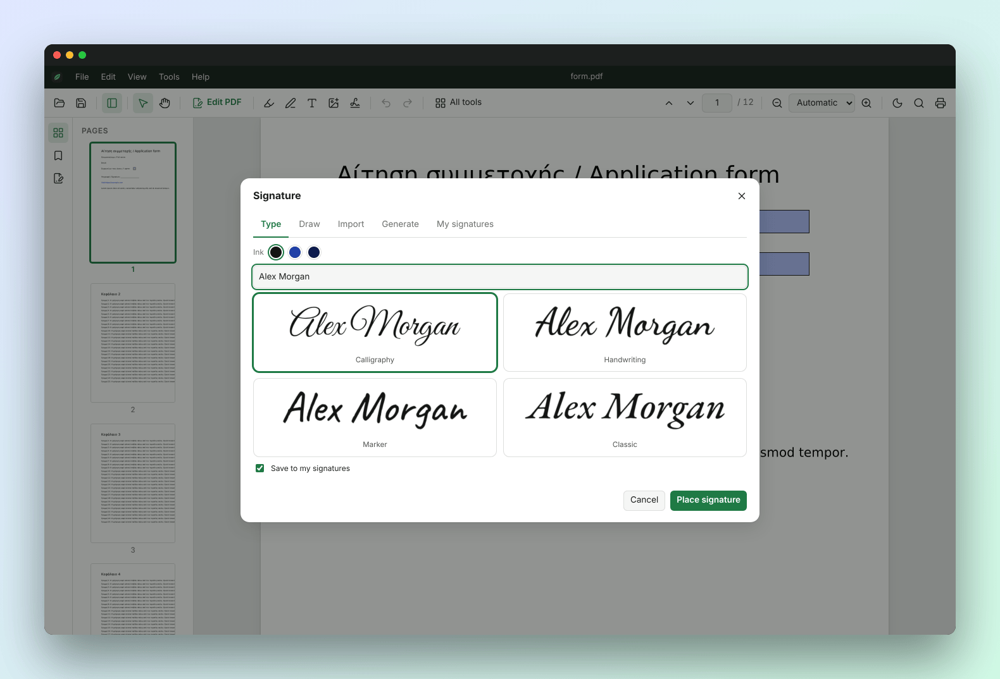
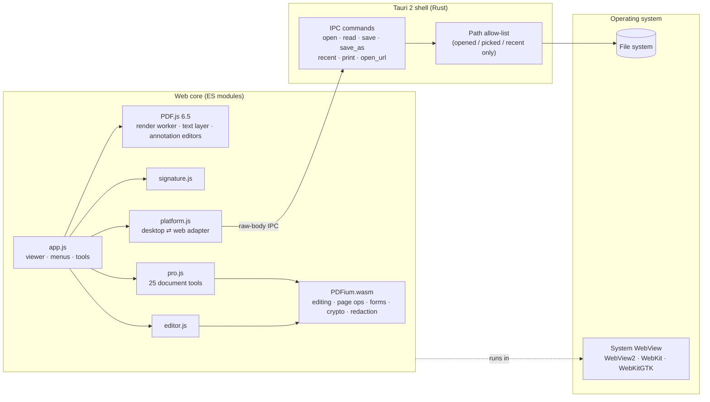

<p align="center">
  
</p>

<h1 align="center">Flipleaf</h1>

<p align="center"><b>Cross-platform PDF reader &amp; editor — native shell, web core, zero telemetry.</b></p>

<p align="center">
  <a href="../../releases/latest"></a>
  <a href="../../releases"></a>
  
  
  
  
  <a href="LICENSE"></a>
</p>

<p align="center">
  <a href="../../releases/latest"><b>Download</b></a> ·
  <a href="https://vasileiostripolidis.github.io/flipleaf/"><b>Web app</b></a> ·
  <a href="#architecture">Architecture</a> ·
  <a href="#build">Build</a> ·
  <a href="#-ελληνικά">Ελληνικά</a>
</p>

<p align="center"></p>

---

## TL;DR

| | |
|---|---|
| **Footprint** | ~6 MB installer; uses the OS web engine (WebView2 / WebKit) instead of bundling Chromium |
| **Engines** | PDF.js 6.5 for rendering, text layer and annotations · PDFium (WASM) for content editing, page ops, forms, encryption, redaction |
| **Shell** | Tauri 2 + ~350 lines of Rust; scoped file I/O through 12 explicit IPC commands |
| **Frontend** | Vanilla ES modules, no framework, no bundler, no runtime dependencies from npm |
| **Privacy** | Fully offline; no telemetry, no accounts; strict CSP blocks all remote connections |
| **Targets** | Windows x64 (NSIS + MSI) · macOS arm64 + x64 (DMG) · Linux x64 (AppImage, deb, rpm) · PWA |
| **i18n** | English, Greek (UI, installers, license) |

---

## Features

<table>
<tr><td width="50%" valign="top">

**Viewer**
- Virtualized rendering: only visible pages hit the canvas; off-screen pages are released
- Single / continuous / two-page (book) / two-page continuous layouts
- Zoom presets, 50–400 %, Ctrl+wheel and pinch
- Thumbnails, outline, comments panel
- Full-text search: match case, whole word, diacritic-insensitive
- Presentation mode, night mode, auto dark theme
- Text-to-speech from the current page
- Per-document state (page, zoom, rotation)
- Encrypted PDFs (user password)

**Annotations**
- Highlight, ink, free text, image, stamps, sticky notes
- Shapes: rectangle, ellipse, line, arrow
- AcroForm filling
- Undo / redo; saved as standard PDF annotations

</td><td width="50%" valign="top">

**Content editing** (PDFium)
- Select and retype existing text objects; font, size, weight, style, color
- Move, scale, replace or delete image objects
- Insert new text, images, signatures
- Font fallback with Latin, Greek, Cyrillic coverage

**Signatures**
- Typed (4 OFL script faces) · drawn (smoothed strokes) · imported (photo/scan with Otsu-threshold background removal) · procedurally generated variants
- Local signature store (12 slots, default slot)
- Click-to-place with live preview

**Document tools** (25)
- Organize, combine, split, extract, insert, crop
- Header/footer, page numbers, watermark, Bates
- Images → PDF, PDF → DOCX / PNG / JPEG / TXT, compression
- Form designer with automatic field detection
- AES-256 encryption + permissions, decryption, true redaction, metadata/attachment sanitizing
- Text diff between two documents

</td></tr>
</table>

<p align="center">
  
  
</p>
<p align="center"></p>

---

## Architecture



**Data flow**

1. The OS launches Flipleaf with a file path. The Rust side records the path in an allow-list and sends the UI only the file's bytes.
2. PDF.js parses the document in a Web Worker. Each page gets a sized placeholder, and an `IntersectionObserver` renders only pages near the viewport.
3. A positioned text layer over each canvas provides selection, search highlights and accessibility.
4. Annotations are created through PDF.js editors and serialized with `saveDocument()`.
5. Content edits and document tools load the current bytes into PDFium (WASM). They operate on page objects (`FPDFPageObj_*`, `FPDFText_SetText`, `FPDF_ImportPagesByIndex`, `EPDF_SetEncryption`, `EPDFText_RedactInRect`…), save with `SaveAsCopy`, and hot-swap the document in the viewer.
6. Saving sends the bytes back over IPC. Rust writes only to paths in the allow-list.

### Security model

| Layer | Measure |
|---|---|
| Content Security Policy | `default-src 'self'`, `connect-src` limited to IPC, `script-src 'self' 'wasm-unsafe-eval'`. No remote origins at all |
| IPC surface | 12 purpose-built commands. No generic fs / shell plugins are exposed to the UI |
| File scope | Read/write is allowed only for paths the user opened, picked in a native dialog, or that are in the recent list |
| Capabilities | Minimal Tauri capability set for the main window (window controls only) |
| Network | None. External links are handed to the OS browser via `open_url` (http/https/mailto only) |
| Encryption | AES-256 via PDFium's standard security handler |
| Redaction | Glyphs and image objects inside the marked area are removed from the content stream, not covered |

Report vulnerabilities privately: [SECURITY.md](SECURITY.md).

### Web / PWA build

The same `src/` folder is deployed to GitHub Pages as an installable PWA. `platform.js` switches the adapter: native dialogs and IPC on desktop, file picker and downloads on the web. A service worker caches the app shell for offline use. Documents never leave the browser.

---

## Tech stack

| Area | Technology |
|---|---|
| Desktop shell | [Tauri 2](https://tauri.app) · Rust · `tauri-plugin-dialog` · `tauri-plugin-opener` |
| Rendering | [PDF.js](https://mozilla.github.io/pdf.js/) 6.5.438 (legacy build), CMaps, standard fonts, ICC, JBIG2/OpenJPEG WASM decoders |
| Editing engine | [PDFium](https://pdfium.googlesource.com/pdfium/) WebAssembly build ([@embedpdf/pdfium](https://www.npmjs.com/package/@embedpdf/pdfium) 2.15) |
| UI | HTML · CSS custom properties (light/dark) · vanilla JS modules · [Lucide](https://lucide.dev) icons |
| Fonts | Flipleaf Sans/Serif (Liberation-derived) · Great Vibes · Dancing Script · Caveat · EB Garamond (all OFL-1.1) |
| Output formats | PDF · DOCX (own OOXML + ZIP writer) · PNG/JPEG · TXT · ZIP |
| Installers | NSIS (EN/EL, custom branding, license page) · WiX MSI · DMG · AppImage · deb · rpm |
| CI/CD | GitHub Actions + `tauri-action` (4-target matrix) · GitHub Pages for the web build |

---

## Build

**Requirements:** [Node.js](https://nodejs.org) 18+, [Rust](https://rustup.rs) stable. On Linux, also `libwebkit2gtk-4.1-dev librsvg2-dev`.

```bash
git clone https://github.com/vasileiostripolidis/flipleaf.git
cd flipleaf
npm install
npm run dev            # desktop app in development mode
npm run build          # installers → src-tauri/target/release/bundle/
```

Web only, no toolchain needed:

```bash
cd src && python3 -m http.server 8000   # http://localhost:8000
```

**Release pipeline.** *Actions → Release → Run workflow* (or push a `v*` tag). This builds Windows x64, macOS arm64, macOS x64 and Linux x64 in parallel and attaches all artifacts to a draft release. Every push to `main` also redeploys the web app.

**Legal files.** After changing `EULA.md` or dependencies, run `python3 scripts/legal.py`. It regenerates the in-app EULA, the installer RTF and `THIRD-PARTY-NOTICES.txt`, including every Rust crate license.

### Project layout

```
src/                       web core (shared by desktop and web)
├─ index.html · style.css  UI shell, light/dark theme
├─ app.js                  viewer, menus, tools, find, print, presentation, TTS
├─ editor.js               content editing (PDFium page objects)
├─ signature.js            signature studio, store, placement
├─ pro.js · pro-strings.js 25 document tools
├─ pdfium.js               PDFium loader, document wrapper, heap helpers
├─ zip.js                  ZIP + DOCX writer
├─ platform.js             desktop ⇄ web adapter
├─ licensing.js            feature tiers (all free during launch)
├─ i18n.js                 EN / EL strings
├─ icons.js                inline Lucide SVGs
├─ sw.js · manifest        PWA
├─ legal/                  EULA + notices shown in-app
└─ vendor/                 pdfjs/ · pdfium/ · fonts/
src-tauri/                 native shell
├─ src/lib.rs              IPC commands, path allow-list, recent files, print
├─ tauri.conf.json         window, CSP, file association, bundles
├─ capabilities/           permission set
└─ installer/              NSIS/WiX/DMG artwork, EULA.rtf, Greek NSIS strings
scripts/legal.py           license/notice generator
.github/workflows/         release.yml (installers) · pages.yml (web)
docs/                      screenshots
```

---

## Install

| Platform | Artifact | Notes |
|---|---|---|
| Windows 10/11 x64 | `Flipleaf_x.y.z_x64-setup.exe` · `…_x64_en-US.msi` | Per-user install, no admin. SmartScreen: *More info → Run anyway* (builds are not code-signed yet) |
| macOS 11+ Apple silicon | `Flipleaf_x.y.z_aarch64.dmg` | First launch: right-click → *Open*, or `xattr -cr /Applications/Flipleaf.app` |
| macOS 11+ Intel | `Flipleaf_x.y.z_x64.dmg` | Same as above |
| Linux x64 (WebKitGTK 4.1) | `.AppImage` · `.deb` · `.rpm` | Ubuntu 22.04+, Debian 12+, Fedora 38+ |
| Browser | [vasileiostripolidis.github.io/flipleaf](https://vasileiostripolidis.github.io/flipleaf/) | Chrome, Edge, Firefox, Safari; installable as PWA |

Registers as a handler for `.pdf`. Updates are installed manually over the previous version; settings and signatures are kept.

### Keyboard

| Keys | Action | Keys | Action |
|---|---|---|---|
| Ctrl+O / S / Shift+S | Open / Save / Save as | Ctrl+E | Edit PDF |
| Ctrl+P | Print | Ctrl+F | Find |
| Ctrl+W | Close | Ctrl+D | Properties |
| Ctrl+ + / − | Zoom | Ctrl+1 / 0 / 2 | Actual / fit page / fit width |
| Ctrl+Shift+ + / − | Rotate | Ctrl+L | Full screen |
| ← → · Home End | Navigate | V / H | Select / hand |
| Ctrl+Z / Y | Undo / redo | F4 | Sidebar |
| Ctrl+Shift+Y | Read aloud | N | Night mode |
| Alt | Menu bar | ? | Shortcut sheet |

⌘ replaces Ctrl on macOS.

---

## Privacy

No accounts, analytics, crash reporting or ads. Documents, settings and signatures stay on the device. The desktop app makes no network requests. → [PRIVACY.md](PRIVACY.md)

## FAQ

- **Cost?** Free, including all document tools. Any future paid tier applies only to future versions.
- **Expiry or kill switch?** None. No server dependency, no license check.
- **Interoperability?** Output is standard PDF. Annotations, signatures and form data render in any compliant reader.
- **Signatures?** Image-based *simple electronic signatures* (eIDAS). Not certificate-based or qualified signatures.

## License

- Code: [MIT](LICENSE) · End-user terms: [EULA.md](EULA.md) · Privacy: [PRIVACY.md](PRIVACY.md) · Security: [SECURITY.md](SECURITY.md)
- "Flipleaf" name and logo are reserved (EULA §3)
- Third-party: PDF.js (Apache-2.0), PDFium (BSD-3-Clause), EmbedPDF build (MIT), Tauri & Rust crates (MIT/Apache-2.0), Lucide (ISC), fonts (OFL-1.1). Full texts: [THIRD-PARTY-NOTICES.txt](THIRD-PARTY-NOTICES.txt)

© 2026 Vasileios Tripolidis

---

## 🇬🇷 Ελληνικά

**Flipleaf**: ελαφρύ πρόγραμμα ανάγνωσης και επεξεργασίας PDF για Windows, macOS, Linux και web. Λειτουργεί εντελώς offline, χωρίς λογαριασμό και χωρίς τηλεμετρία.

- **Λήψη:** [Releases](../../releases/latest) → `…x64-setup.exe` (Windows), `…aarch64.dmg` (Mac Apple), `…x64.dmg` (Mac Intel), `.AppImage`/`.deb`/`.rpm` (Linux) · ή [έκδοση web](https://vasileiostripolidis.github.io/flipleaf/)
- **Πρώτη εκκίνηση:** Windows → *Περισσότερες πληροφορίες → Εκτέλεση οπωσδήποτε* · Mac → δεξί κλικ → *Άνοιγμα*
- **Λειτουργίες:**
  - προβολή, αναζήτηση και σχόλια
  - επεξεργασία κειμένου και εικόνων μέσα στο PDF
  - υπογραφές: πληκτρολόγηση, σχεδίαση, εισαγωγή φωτογραφίας, αυτόματη δημιουργία
  - 25 εργαλεία: οργάνωση, συνδυασμός, διαχωρισμός, μετατροπή σε Word/εικόνες/κείμενο, συμπίεση, φόρμες, κρυπτογράφηση AES-256, redaction, σύγκριση
- **Τεχνολογία:** Tauri 2 (Rust), PDF.js, PDFium σε WebAssembly, vanilla JS
- **Απόρρητο:** τα αρχεία δεν φεύγουν ποτέ από τη συσκευή
- **Άδεια:** κώδικας MIT · όροι χρήσης [EULA.md](EULA.md)
