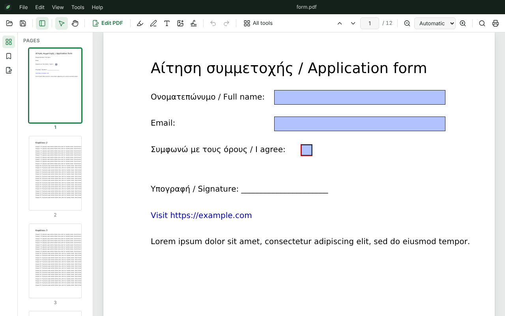
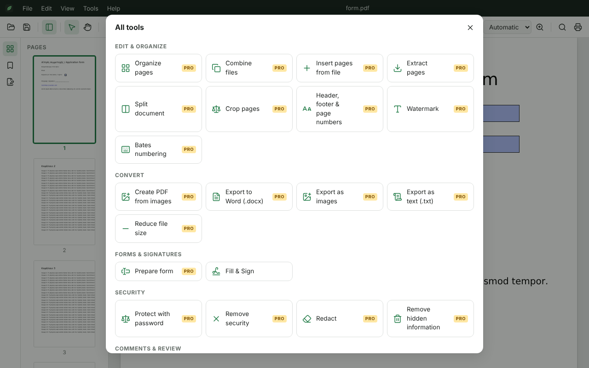

<p align="center">
  
</p>

<h1 align="center">Flipleaf</h1>
<p align="center"><b>A free, light and private PDF reader and editor for Windows, macOS and Linux.</b><br>
Read, edit, sign, organize, convert and protect PDFs. No account, no subscription, your files never leave your computer.</p>

<p align="center">
  <a href="../../releases/latest"><b>⬇ Download</b></a> ·
  <a href="https://vasileiostripolidis.github.io/flipleaf/">Use it in your browser</a> ·
  <a href="#-ελληνικά">Ελληνικά</a>
</p>

<p align="center"></p>

---

## Contents

- [Download and install](#download-and-install)
- [What Flipleaf does](#what-flipleaf-does)
- [Signatures](#signatures)
- [Edit PDF](#edit-pdf)
- [All tools](#all-tools)
- [Keyboard shortcuts](#keyboard-shortcuts)
- [Privacy](#privacy)
- [System requirements](#system-requirements)
- [Questions and answers](#questions-and-answers)
- [Troubleshooting](#troubleshooting)
- [For developers](#for-developers)
- [License and legal](#license-and-legal)
- [Ελληνικά](#-ελληνικά)

---

## Download and install

Open the **[latest release](../../releases/latest)** and download the file for your computer:

| Your computer | File |
|---|---|
| Windows 10 / 11 | `Flipleaf_x.y.z_x64-setup.exe` (recommended) or `…_x64_en-US.msi` (for IT departments) |
| Mac with Apple chip (M1–M4) | `Flipleaf_x.y.z_aarch64.dmg` |
| Mac with Intel chip | `Flipleaf_x.y.z_x64.dmg` |
| Linux | `.AppImage` (any distribution), `.deb` (Ubuntu, Debian, Mint), `.rpm` (Fedora, openSUSE) |

**Windows.** Run the setup file. No administrator rights are needed. The installer is available in English and Greek and shows the license agreement.
If a blue "Windows protected your PC" window appears, click **More info → Run anyway**. This appears because the app is not yet code-signed.

**macOS.** Open the `.dmg` and drag Flipleaf to Applications. The first time, right-click the app → **Open** → **Open**.
If macOS still refuses, run `xattr -cr /Applications/Flipleaf.app` in Terminal.

**Linux.** Install the `.deb`/`.rpm` with your package manager, or make the `.AppImage` executable (`chmod +x`) and run it.

**Make it your default PDF app.** Right-click any PDF → **Open with → Flipleaf** → "Always". After that, double-clicking a PDF opens it in Flipleaf.

**Without installing.** The [web version](https://vasileiostripolidis.github.io/flipleaf/) has the same features and runs in Chrome, Edge, Firefox or Safari. Files are opened inside your browser and are not uploaded. In the web version, *Save* downloads the edited file. You can also install it as an app from the browser's menu.

**Update.** Download the new version and install it over the old one. Your settings and saved signatures are kept. Flipleaf never updates itself.

**Uninstall.** Windows: *Settings → Apps → Flipleaf → Uninstall* (you can choose to delete your settings and saved signatures too). macOS: drag the app to the Trash. Linux: remove the package.

---

## What Flipleaf does

### Read
- Fast, smooth scrolling, even for documents with hundreds of pages
- Page layouts: single page, continuous, two pages (book view), two pages continuous
- Zoom: automatic, actual size, fit page, fit width, 50–400 %, Ctrl + mouse wheel or trackpad pinch
- Page thumbnails, bookmarks (table of contents) and comments in the sidebar
- Search with highlight-all, match case, whole words and accent-insensitive matching (`cafe` finds `Café`, `φυλλο` finds `ΦΎΛΛΟ`)
- Clickable links and table-of-contents entries
- Rotate pages, full-screen presentation mode, night reading, automatic dark theme
- Read aloud (text-to-speech) from the current page
- Remembers the last page, zoom and rotation of every document
- Opens password-protected PDFs
- Document properties: title, author, dates, PDF version, page size and more

### Comment and fill in
- Highlight text (5 colors)
- Freehand drawing with pen color and thickness
- Text boxes
- Images and stamps
- Sticky notes and a comments panel
- Shapes: rectangle, ellipse, line, arrow
- Fill in PDF forms (text fields, checkboxes, lists)
- Undo / redo
- Everything is saved as standard PDF annotations, so it shows up in every other PDF reader

### Files
- Classic menu bar: File, Edit, View, Tools, Help
- Open by double-click, *Open with*, the Open dialog, drag and drop, paste (Ctrl+V) or *File → Open recent*
- Save (overwrites safely) and Save as. Flipleaf warns before closing a document with unsaved changes
- Print, including your comments, signatures and form entries
- English and Greek interface (follows your computer's language)

---

## Signatures

<p align="center"></p>

Click the **signature** button in the toolbar (or *Tools → Fill & Sign*). There are five ways to create a signature:

| Tab | What it does |
|---|---|
| **Type** | Type your name and pick one of 4 signature styles: Calligraphy, Handwriting, Marker, Classic. Greek names are written in Latin letters automatically (can be turned off) |
| **Draw** | Sign with the mouse, trackpad, pen or finger. Pen or marker, 3 thicknesses, undo and clear |
| **Import** | Upload a photo or scan of your real signature on paper. The background is removed automatically; a slider fine-tunes it |
| **Generate** | Creates several signature variations from your name (different slant and flourishes) so you can pick one you like |
| **My signatures** | Up to 12 saved signatures. Mark one as default; delete the ones you no longer need |

Choose the ink color (black, blue, dark blue), click **Place signature**, then click on the page where it should go. You can then move and resize it.
Signatures are saved only on your computer.

> Signatures made with Flipleaf are *simple electronic signatures* (an image on the page). They are not certificate-based or qualified electronic signatures. For documents that legally require a qualified signature, use the official service of your country.

---

## Edit PDF

<p align="center"></p>

Click **Edit PDF** (Ctrl+E) to change the content of the document itself:

- Click on existing text to select it, double-click to retype it
- Change the font (sans / serif), size, bold, italic and color
- Move, resize, replace or delete existing images
- Add new text, images and signatures
- Undo while editing; *Cancel* discards all changes, *Done* keeps them
- Keeps the document's own font when possible. Greek, Latin and Cyrillic text is always supported

---

## All tools

<p align="center"></p>

*Tools → All tools* or the **All tools** button. These are "Pro" tools and are **free** during the launch period.

**Edit and organize**
- Organize pages: drag to reorder, rotate, delete, insert blank pages or pages from another PDF, extract, split
- Combine several PDFs into one
- Split a document every N pages
- Extract pages (into one file or one file per page)
- Insert pages from another file
- Crop pages
- Header, footer and page numbers (with page, total pages, date and file name)
- Watermark (text, size, color, opacity, angle)
- Bates numbering for legal documents

**Convert**
- Create a PDF from images (JPG, PNG, WebP…)
- Export to Word (.docx)
- Export pages as images (PNG / JPEG, choice of resolution)
- Export as plain text (.txt)
- Reduce file size (three quality levels)

**Forms and signatures**
- Prepare a form: add text fields, checkboxes and signature fields, or detect fields automatically
- Fill and sign (see [Signatures](#signatures))

**Security**
- Protect with a password (AES-256), with permissions for printing, copying, editing and comments
- Remove security from documents you are allowed to unlock
- True redaction: the content under the black boxes is deleted from the file, not just covered. Also *find & mark* to redact every occurrence of a word
- Remove hidden information (metadata and attachments)

**Comments and review**
- Sticky notes and a comments panel
- Stamps: Approved, Rejected, Draft, Confidential, Final, Received, Reviewed, Void, or your own text, with optional date
- Shapes: rectangle, ellipse, line, arrow
- Compare two versions of a document and see the added and removed text

---

## Keyboard shortcuts

On a Mac, use ⌘ instead of Ctrl. Press **?** in the app to see this list.

| Key | Action |
|---|---|
| Ctrl+O / Ctrl+S / Ctrl+Shift+S | Open / Save / Save as |
| Ctrl+P | Print |
| Ctrl+W | Close document |
| Ctrl+E | Edit PDF |
| Ctrl+F | Find (Enter / Shift+Enter for next / previous) |
| Ctrl++ / Ctrl+− | Zoom in / out |
| Ctrl+1 / Ctrl+0 / Ctrl+2 | Actual size / fit page / fit width |
| Ctrl+Shift++ / Ctrl+Shift+− | Rotate |
| ← / → · Home / End | Previous / next page · first / last page |
| Ctrl+L | Full screen |
| V / H | Select tool / hand tool |
| Ctrl+Z / Ctrl+Y | Undo / redo |
| F4 | Sidebar |
| Ctrl+D | Document properties |
| Ctrl+Shift+Y | Read aloud |
| N | Night reading |
| Alt | Open the menu bar |
| ? | All shortcuts |

---

## Privacy

- No account, no analytics, no tracking, no ads
- Your documents are opened, edited and saved only on your computer. Nothing is uploaded
- The desktop app works fully offline. It goes online only if you click a web link inside a document (it opens in your browser)

Full text: [PRIVACY.md](PRIVACY.md).

---

## System requirements

| System | Minimum |
|---|---|
| Windows | Windows 10 or 11, 64-bit. Uses Microsoft Edge WebView2, which is already part of Windows 11 and recent Windows 10 (the installer adds it if missing) |
| macOS | macOS 11 (Big Sur) or later recommended, Apple chip or Intel |
| Linux | 64-bit distribution with WebKitGTK 4.1 (Ubuntu 22.04+, Debian 12+, Fedora 38+ or similar) |
| Web | A current version of Chrome, Edge, Firefox or Safari |

About 6 MB to download. Flipleaf uses the browser engine already built into your system instead of bundling its own, which is why it is so small.

---

## Questions and answers

**Is it really free?** Yes. All features, including the Pro tools, are free. If some Pro tools become paid in the future, that will apply only to future versions. Versions you already have stay free.

**Will it stop working one day?** No. Flipleaf does not depend on any server, has no license check and does not expire.

**Does it upload my files?** No. Everything happens on your computer, also in the web version.

**Can I use it at work?** Yes, for personal, educational, business and government use, on any number of computers.

**Are my edits visible in other programs?** Yes. Flipleaf saves standard PDF files. Comments, signatures and form entries appear in every PDF reader.

**Is a Flipleaf signature legally valid?** It is a simple electronic signature. Its value depends on the document and the law that applies. See the note in [Signatures](#signatures).

**Can I recover a document after saving?** Save overwrites the file. Keep a copy of important documents, or use *Save as* to save the edited version under a new name.

---

## Troubleshooting

| Problem | Solution |
|---|---|
| Windows shows "Windows protected your PC" | *More info → Run anyway* |
| macOS says the app "can't be opened" | Right-click the app → *Open*, or `xattr -cr /Applications/Flipleaf.app` |
| Double-clicking a PDF opens another program | Right-click a PDF → *Open with → Flipleaf* → "Always" |
| A password-protected PDF won't open | Flipleaf asks for the password; you need the password set by the document's author |
| A text in Edit PDF can't be changed | Some PDFs contain text as an image (scans). It can be covered with a new text box or image instead |
| Something else | Open an [issue](../../issues) with the version (*Help → About Flipleaf*) and a description |

Security problems: please report them privately, see [SECURITY.md](SECURITY.md).

---

## For developers

### How it is built
- Desktop shell: [Tauri 2](https://tauri.app) (Rust). It uses the system web engine: WebView2 on Windows, WebKit on macOS and Linux
- Viewer and annotations: Mozilla [PDF.js](https://mozilla.github.io/pdf.js/), the same engine Firefox uses
- Editing, conversion and security tools: [PDFium](https://pdfium.googlesource.com/pdfium/) compiled to WebAssembly
- Interface: plain HTML, CSS and JavaScript modules, no framework
- File access: the interface can read or write only files you opened, picked in a dialog or that are in your recent list. It has no general access to your disk

### Build from source
You need [Node.js](https://nodejs.org) and [Rust](https://rustup.rs). On Linux also `libwebkit2gtk-4.1-dev librsvg2-dev`.

```bash
npm install
npm run dev      # run the app in development mode
npm run build    # create an installer in src-tauri/target/release/bundle/
```

Web version only: `cd src && python3 -m http.server 8000`, then open http://localhost:8000.

Installers for all platforms are built by GitHub Actions: *Actions → Release → Run workflow* (or push a `v*` tag). The result is a draft release with all files attached.

### Project layout
```
src/                     the app (shared by desktop and web)
  index.html, style.css  interface
  app.js                 viewer, menus, tools, find, print, presentation, read aloud
  signature.js           create, save and place signatures
  editor.js              Edit PDF (text and images, PDFium)
  pro.js, pro-strings.js All tools (organize, convert, forms, security, comments)
  pdfium.js, zip.js      PDFium helpers; ZIP and .docx writer
  licensing.js           plans and feature gating (Pro is free during launch)
  platform.js            desktop / web differences (files, dialogs, window)
  i18n.js                English and Greek text
  icons.js               Lucide icons
  legal/                 license agreement and third-party notices shown in the app
  vendor/                PDF.js, PDFium, fonts
src-tauri/               desktop shell (Tauri 2 / Rust)
  src/lib.rs             open/save dialogs, file access, recent files, printing
  tauri.conf.json        window, security policy, .pdf association, installers
  installer/             installer images, license (RTF) and Greek installer text
scripts/legal.py         generates the license and notices files
.github/workflows/       release builds and the web version
docs/                    screenshots for this page
```

---

## License and legal

- **Source code:** [MIT License](LICENSE)
- **License agreement for users:** [EULA.md](EULA.md) (English and Greek). Shown in the Windows installer and on first launch, and always available from *Help → License & third-party notices*
- **Name and logo:** "Flipleaf" and the leaf logo are not covered by the MIT License (see EULA §3)
- **Privacy:** [PRIVACY.md](PRIVACY.md) · **Security reports:** [SECURITY.md](SECURITY.md)
- **Third-party components:** [THIRD-PARTY-NOTICES.txt](THIRD-PARTY-NOTICES.txt). Mozilla PDF.js (Apache-2.0), PDFium (BSD-3-Clause), EmbedPDF PDFium build (MIT), Tauri and Rust crates (MIT / Apache-2.0), Lucide icons (ISC), Liberation-derived fonts and the signature fonts Great Vibes, Dancing Script, Caveat, EB Garamond (OFL-1.1)
- After changing `EULA.md` or dependencies, regenerate the legal files: `python3 scripts/legal.py`

Copyright © 2026 Vasileios Tripolidis.

---

## 🇬🇷 Ελληνικά

Το **Flipleaf** είναι δωρεάν, ελαφρύ πρόγραμμα PDF για Windows, macOS και Linux. Διαβάζεις, επεξεργάζεσαι, υπογράφεις, οργανώνεις, μετατρέπεις και προστατεύεις PDF. Δεν θέλει λογαριασμό ή συνδρομή και τα αρχεία σου δεν φεύγουν ποτέ από τον υπολογιστή σου. Η εφαρμογή εμφανίζεται στα ελληνικά όταν ο υπολογιστής σου είναι στα ελληνικά.

### Κατέβασμα και εγκατάσταση

Από τη σελίδα **[Releases](../../releases/latest)**:

| Υπολογιστής | Αρχείο |
|---|---|
| Windows 10 / 11 | `…_x64-setup.exe` |
| Mac με τσιπ Apple (M1–M4) | `…_aarch64.dmg` |
| Mac με Intel | `…_x64.dmg` |
| Linux | `.AppImage`, `.deb` ή `.rpm` |

- **Windows:** τρέχεις το αρχείο, δεν χρειάζονται δικαιώματα διαχειριστή. Αν εμφανιστεί μπλε παράθυρο, πατάς *Περισσότερες πληροφορίες → Εκτέλεση οπωσδήποτε*.
- **Mac:** σέρνεις το Flipleaf στις Εφαρμογές. Την πρώτη φορά: δεξί κλικ → *Άνοιγμα* → *Άνοιγμα*.
- **Προεπιλογή:** δεξί κλικ σε ένα PDF → *Άνοιγμα με → Flipleaf* → «Πάντα».
- **Χωρίς εγκατάσταση:** η [έκδοση web](https://vasileiostripolidis.github.io/flipleaf/) έχει τις ίδιες λειτουργίες. Τα αρχεία μένουν στον browser σου.
- **Ενημέρωση:** κατεβάζεις τη νέα έκδοση και την εγκαθιστάς από πάνω. Ρυθμίσεις και υπογραφές διατηρούνται.

### Λειτουργίες

- **Ανάγνωση:** γρήγορη κύλιση, μονή/διπλή σελίδα, zoom, μικρογραφίες, σελιδοδείκτες, αναζήτηση (και χωρίς τόνους), παρουσίαση, νυχτερινή ανάγνωση, ανάγνωση φωναχτά, αρχεία με κωδικό.
- **Σχόλια & συμπλήρωση:** επισήμανση, ελεύθερη σχεδίαση, πλαίσια κειμένου, εικόνες, σημειώσεις, σφραγίδες, σχήματα, συμπλήρωση φορμών, αναίρεση.
- **Υπογραφές:** πληκτρολόγηση με 4 στυλ, σχεδίαση, εισαγωγή φωτογραφίας της πραγματικής σου υπογραφής (αφαιρεί αυτόματα το φόντο), αυτόματη δημιουργία παραλλαγών, έως 12 αποθηκευμένες υπογραφές. Τοποθέτηση με ένα κλικ.
- **Επεξεργασία PDF (Ctrl+E):** αλλαγή του υπάρχοντος κειμένου (γραμματοσειρά, μέγεθος, έντονα, πλάγια, χρώμα), μετακίνηση/αλλαγή/διαγραφή εικόνων, προσθήκη κειμένου, εικόνων και υπογραφής.
- **Όλα τα εργαλεία** (δωρεάν):
  - *Οργάνωση:* σελίδες (σειρά, περιστροφή, διαγραφή, εισαγωγή), συνδυασμός αρχείων, διαχωρισμός, εξαγωγή, περικοπή, κεφαλίδα/υποσέλιδο/αρίθμηση, υδατογράφημα, αρίθμηση Bates.
  - *Μετατροπή:* PDF από εικόνες, εξαγωγή σε Word, εικόνες ή κείμενο, μείωση μεγέθους.
  - *Φόρμες:* δημιουργία φόρμας και αυτόματος εντοπισμός πεδίων.
  - *Ασφάλεια:* κωδικός AES-256 με δικαιώματα, αφαίρεση προστασίας, πραγματική απόκρυψη (redaction), αφαίρεση κρυφών πληροφοριών.
  - *Αναθεώρηση:* σχόλια, σφραγίδες, σχήματα, σύγκριση δύο εκδόσεων.
- **Αρχεία:** αποθήκευση και αποθήκευση ως, εκτύπωση με σχόλια και υπογραφές, πρόσφατα αρχεία, ιδιότητες εγγράφου.

### Συχνές ερωτήσεις

- **Είναι δωρεάν;** Ναι, όλες οι λειτουργίες. Αν κάποτε κάποια εργαλεία γίνουν επί πληρωμή, θα ισχύει μόνο για νέες εκδόσεις.
- **Θα σταματήσει να λειτουργεί;** Όχι. Δεν εξαρτάται από κανέναν server και δεν λήγει.
- **Ανεβαίνουν τα αρχεία μου κάπου;** Όχι, ποτέ.
- **Ισχύει νομικά η υπογραφή;** Είναι απλή ηλεκτρονική υπογραφή (εικόνα). Για έγγραφα που απαιτούν εγκεκριμένη υπογραφή χρησιμοποίησε την επίσημη υπηρεσία (π.χ. gov.gr).
- **Πρόβλημα;** Άνοιξε ένα [issue](../../issues) με την έκδοση (*Βοήθεια → Σχετικά με το Flipleaf*) και περιγραφή.

Άδεια χρήσης: [EULA.md](EULA.md) · Απόρρητο: [PRIVACY.md](PRIVACY.md) · Ασφάλεια: [SECURITY.md](SECURITY.md)
